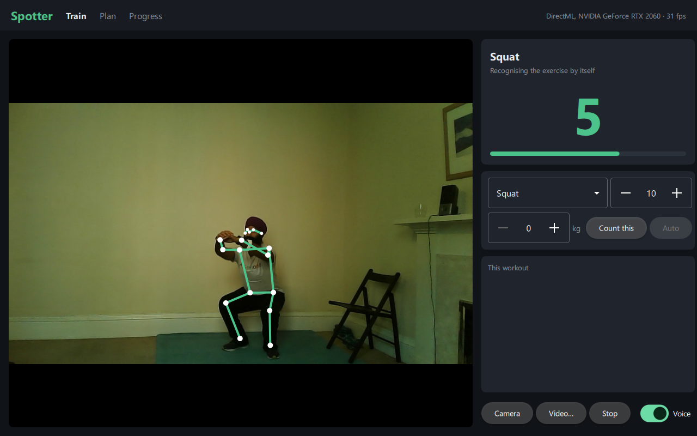
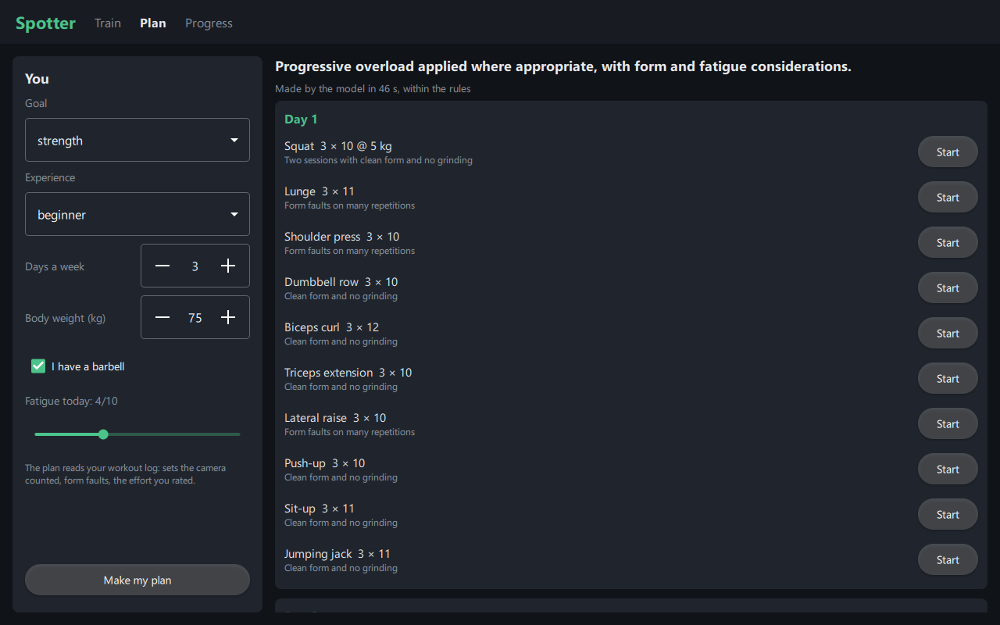
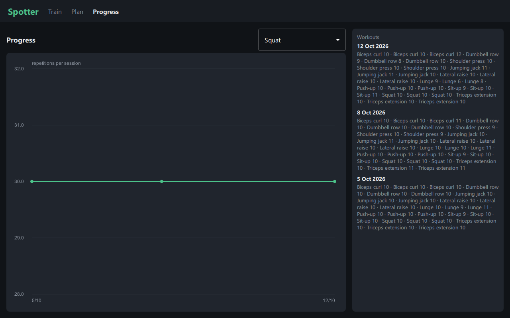

# Spotter

A gym coach that watches through the camera. It finds your skeleton in every frame, recognises the
exercise, counts the repetitions out loud and tells you when your form slips, all live on your own
machine. A local language model writes your training plan from the workout log and adjusts it after
every session and to how tired you say you are. A rule set checks every number the model writes.



| The plan, from the log | Progress |
|---|---|
|  |  |

The pictures are Spotter replaying workouts of the [MM-Fit dataset](https://mmfit.github.io/)
(CC BY 4.0), the recordings it is evaluated on: the laptop it was built on has no camera. A webcam
works the same way ("Camera").

## How it works

```
camera ─► YOLOX-tiny (person) ─► RTMPose-m (17 joints) ─► One Euro smoothing ─► 30 Hz track
                                                                                    │
            ┌──────────────────────────────────────────────────────────────────────┤
            ▼                                    ▼                                  ▼
  exercise classifier (TCN,          repetition counter                    skeleton drawn
  2.1 s of joints, every 1/6 s)      (one body signal per exercise)        over the picture (QML)
            │                                    │
            └─► a set starts / ends ─────────────┤
                                                 ▼
                                   form checks on each repetition ─► voice: "seven", "knees out"
                                                 │
                                                 ▼
                     SQLite workout log ─► planner: Qwen2.5-7B writes the plan, the rules check it
```

- **Pose** (C++, ONNX Runtime with DirectML on Windows, the CPU elsewhere). YOLOX-tiny finds the
  lifter, RTMPose-m puts 17 COCO joints on them. Once found, the person is tracked from the last
  skeleton's box; the detector runs again only when the skeleton gets unsure, or every two seconds.
  On an RTX 2060 a frame takes 8–9 ms, so the pipeline runs at about 80 frames a second, faster than
  any webcam. On the CPU alone it is 24 ms, which is enough for 30 fps.
- **Exercise classifier** (PyTorch, exported to ONNX). A small temporal convolution network looks at
  the last 64 frames of raw joints. The normalisation is part of the ONNX graph, so C++ and Python
  cannot disagree about it: centre on the hips, scale by the torso, mask unsure joints. It knows the
  ten MM-Fit exercises and "none". A set starts when one exercise holds for 0.8 s; the last 3 s are
  replayed into the counter, so the repetitions done while it made up its mind count. The set ends
  after 3 s without the exercise.
- **Repetition counter.** Each exercise has one signal that goes out and back once per repetition,
  measured in body units so that it does not depend on the camera: the hips' height above the ankles
  for squats, the elbow angle for curls, the wrists above the shoulders for raises. A Schmitt trigger
  counts it. The signal, its direction and its range were chosen per exercise on MM-Fit's training
  workouts, among nine candidates
  ([train/spotter_train/tune_reps.py](train/spotter_train/tune_reps.py), [core/exercises.inc](core/exercises.inc)).
  It counts from the turning point of each repetition, not from where the set began, so a lifter who
  starts higher than they come back to is still counted.
- **Form checks** look at each finished repetition, and only where the camera can see the fault:
  - **from the front:** knees caving in at the bottom of a squat or lunge, and uneven hands at the
    top of a press;
  - **from the side:** hips rising faster than the shoulders off the floor in a deadlift, and the
    hips sagging in a push-up;
  - **from any angle:** squat depth, the deadlift lockout, the body swinging in a curl or a raise,
    and lateral raises going above the shoulders.

  Rounding of the back cannot be seen from 17 joints: there are none along the spine. Spotter does
  not pretend to check it.
- **Voice.** Spotter speaks the count and one cue per faulty repetition through the system's speech
  synthesiser (SAPI on Windows, spd-say or espeak-ng on Linux).
- **Planner.** The language model is Qwen2.5-7B-Instruct in llama.cpp, held to a JSON schema. It gets:
  - the lifter's profile and today's fatigue;
  - the current plan;
  - the last sessions of every exercise, as the camera logged them: repetitions done against
    planned, effort felt (RPE), and repetitions with form faults.

  It writes the next plan, with a reason for every number. Then the rules check every number, and
  where the model's number breaks them, the rule's number replaces it and the plan says so. The
  rules are a standard linear progression:
  - add one step (or one repetition) after a clean, completed session;
  - hold after missed repetitions, a very hard session or many form faults;
  - take 10% off after two missed sessions in a row;
  - one set fewer at fatigue 8 or more, and 10% lighter at 9 or 10.

  Without the model, the plan comes from the rules alone.

## Results

All numbers come from [MM-Fit](https://mmfit.github.io/) (Strömbäck et al., IMWUT 2020): 21
workouts, 10 exercises, every set labelled with its start, end and repetitions, filmed from the
front. Spotter uses the dataset's own split:

- the classifier trains on 10 workouts and is selected on 3;
- the counter's settings are chosen on the same 10 workouts;
- the tests are 5 workouts of **people never seen in training** and 3 of people who were.

### The whole coach, end to end

Each test workout goes through `spotter-cli run` from start to finish, exactly as the app runs it:
sets start and end on their own, and nobody tells it which exercise is coming. Each labelled set is
matched to the predicted set that overlaps it most.

| Unseen people (139 sets) | Spotter's pose model on the videos | MM-Fit's own skeletons (OpenPose) |
|---|---|---|
| Sets found | 100% | 98% |
| Exercise right (of sets found) | 100% | 100% |
| Repetitions: mean error per set | **0.22** | 0.40 |
| Repetitions exactly right | **82%** | 77% |
| Within one repetition | **97%** | 93% |
| Sets started where none was labelled | 8 | 0 |

The people seen in training (90 sets, OpenPose skeletons): every set found and recognised, a mean
error of 0.14 repetitions, 86% exact.

**Per exercise** (Spotter's pose model, unseen people, the counter alone over each labelled set
plus a second either side):

| Exercise | Signal | Exact | Within one | Mean error |
|---|---|---|---|---|
| Squat | hip height | 100% | 100% | 0.00 |
| Push-up | hip height | 93% | 93% | 0.13 |
| Shoulder press | elbow angle | 83% | 100% | 0.17 |
| Biceps curl | elbow angle | 77% | 100% | 0.23 |
| Triceps extension | wrists above shoulders | 73% | 100% | 0.27 |
| Dumbbell row | elbow angle | 67% | 93% | 0.40 |
| Lateral raise | wrists above shoulders | 75% | 83% | 0.42 |
| Lunge | hip height | 80% | 87% | 0.53 |
| Sit-up | nose above hips | 33% | 93% | 0.73 |
| Jumping jack | wrists above shoulders | 75% | 75% | 0.92 |

What the numbers show:
- **Sit-ups are the weak exercise.** The lifter lies down with their side or feet to the camera, and
  one of the five unseen people sits up at an angle where no signal moves much.
- **Jumping jacks lose several repetitions in a few sets.**
- **The 8 extra sets are real.** In workout w12 the lifter did two sets of curls, three of seated
  lateral raises and three of jumping jacks (10 to 12 repetitions each) that MM-Fit did not label.
  Checked on the video. Before a rule dropped sets the classifier started with fewer than three
  repetitions, there were 8 more: short moves between sets, none over 5 s.
- **Counting from Spotter's own skeletons is better than from the dataset's OpenPose skeletons** on
  the same videos.

MM-Fit has no deadlifts. Spotter's deadlift settings (the hip angle, counted at lockout) and its
deadlift checks were set by hand and are tested only on synthetic lifters
([tests/test_reps.cpp](tests/test_reps.cpp)), not on real lifts.

### The exercise classifier

On 2.1 s windows, against the label of the window's second half:

| | Macro F1 | Accuracy | Accuracy on exercise windows |
|---|---|---|---|
| Validation | 0.989 | 99.2% | 98.8% |
| Test, seen people | 0.993 | 99.7% | 99.4% |
| Test, unseen people | 0.969 | 98.5% | 95.5% |

The hardest classes for unseen people are sit-ups (F1 0.86) and biceps curls (F1 0.92). In whole
sets the classifier makes no mistakes, because a set is decided over many windows.

### Form checks

MM-Fit has no form labels, so the checks were measured on two things: the real repetitions of the
test workouts as filmed, and the same repetitions with a fault of a known size added, growing with
the depth of each repetition ([train/spotter_train/form_eval.py](train/spotter_train/form_eval.py)):

| Check | On the real repetitions | Fault added: small | medium | large |
|---|---|---|---|---|
| Knees caving in, squat (knees moved 30 / 50 / 70% towards the middle) | 0 of 229 | 21% | 63% | 69% |
| Swinging, curl (body leaning back 10 / 20 / 30°) | 0 of 225 | 2% | 100% | 100% |
| Uneven press (one hand 0.2 / 0.35 / 0.5 torso lower) | 0 of 185 | 0% | 83% | 88% |

The checks stay quiet on ordinary repetitions. They catch clear faults reliably, and small ones
rarely, which is the intended trade: a coach who cues every rep is ignored. Of the other checks, on
the same real repetitions:
- "go deeper" fired on 6 of 229 squats;
- "lock out overhead" fired on 8 of 185 presses.

### Pose model

On all 96,097 frames of the test workout w20, it found the person in 99.1% of frames. Against
OpenPose's joints (MM-Fit's own skeletons), the median distance per joint is 0.04 torso lengths for
the ankles, 0.06–0.09 for the hips, knees, shoulders and face, and up to 0.16 for the wrists and one
ear. Across the five test videos it found the person in 99.1–99.99% of frames, at 77–87 frames a
second on the RTX 2060 (48 for one video processed while another job shared the GPU).

### The planner

[cli/plan_eval.cpp](cli/plan_eval.cpp) builds training logs that cover each situation the
progression rules tell apart:
- a clean session;
- a session with missed repetitions, once and twice in a row;
- a grinding session (RPE 9.5);
- a session with form faults on half the repetitions;
- fatigue reported at 3, 8 and 9 out of 10.

That makes 11 logged lifters with 8 exercises each, plus 5 first plans for different lifters with
no log. Qwen2.5-7B-Instruct (Q4_K_M, temperature 0) plans each one. Its numbers are compared with
the rules': does it go up, stay or go down where the rules do, and would the check have to change
it? Three versions of the prompt:

| | Raw log | Log with its facts spelled out | ...and an explicit decision per exercise |
|---|---|---|---|
| Plans usable (valid, complete) | 12 of 16 | 16 of 16 | 15 of 16 |
| Same direction as the rules | 33% | 39% | **55%** |
| – after a clean session (increase) | 1 of 8 | 1 of 8 | 5 of 8 |
| – after missed or hard sessions (hold) | 24 of 24 | 24 of 24 | 12 of 24 |
| – after two missed sessions (deload) | 0 of 8 | 1 of 8 | 6 of 8 |
| – when tired (one set fewer) | 4 of 48 | 8 of 48 | 25 of 48 |
| Logged numbers the check had to change | 60% | 59% | **48%** |
| Median time per plan | 18 s | 25 s | 12 s |

- **"Log with its facts spelled out"** means each session is written as "missed 2 repetitions",
  "RPE 9.5 (very hard)" or "form faults on 5 of 15 repetitions (many)", where the raw log only had
  "done 5/5/3".
- **"An explicit decision per exercise"** means the schema asks for start, increase, hold, deload or
  reduce before the numbers.
- **The first two prompts look perfect at holding** because the model held almost everything: it
  ignored fatigue and two missed sessions in a row.
- **With the decision step it reads the log far better,** but it still keeps all the sets on half
  of the days the lifter reported being tired.
- **For a first plan,** the model's weights stayed within a safe start for the beginners. For the
  tired intermediate lifter (fatigue 8) it wrote three sets of everything, where the rules allow two.

So a 7B model on its own would give the wrong advice on about half the numbers. That is why
Spotter keeps the check: what the lifter sees is always the model's plan where it agrees with the
rules, and the rules' number, marked "Adjusted" with the reason, where it does not. The model's part
is the program's shape and the explanations; the safety of the numbers does not depend on it.
The app uses the third prompt.

## Running it

What you need:
- CMake 3.24 or newer and a C++20 compiler (Visual Studio 2022 on Windows);
- Qt 6.8 or newer (open source);
- Python 3.14, for training and evaluation only.

```bash
bash scripts/fetch-deps.sh --llm
```

```bash
pip install py7zr && python scripts/fetch-qt.py
```

```bash
cmake -S . -B build -DCMAKE_PREFIX_PATH=third_party/qt && cmake --build build --config Release
```

- `fetch-deps.sh` downloads the pose models, ONNX Runtime (DirectML) and OpenCV, and with `--llm`
  also Qwen2.5-7B and llama.cpp's server. Every file is SHA-checked.
- `fetch-qt.py` gets an open-source Qt 6.11 for Windows. Skip it if you have Qt: point
  `CMAKE_PREFIX_PATH` at yours. On Linux, install `libopencv-dev` and Qt from your distribution.

Then run `build/Release/spotter.exe`, with Qt's `bin` folder on the PATH (or after `windeployqt`):

- **Camera** starts the webcam.
- **Video…** plays a recording at its own speed.
- **Count this** counts a planned set: use it for the deadlift, which the classifier does not know,
  or when you want the plan's numbers in the log.
- After a set, tap how hard it felt (RPE 6–10).
- On **Plan**, give your fatigue and make the plan.

The command line, for scripts and evaluation:

```bash
build/Release/spotter-cli pose video.mp4 out.kp
```

```bash
build/Release/spotter-cli run out.kp
```

- `pose` writes the skeletons of a video and reports the speed.
- `run` prints the live coach's events as JSON lines: sets, repetitions, faults.
- `count` and `signals` look at one segment.
- `plan-eval` runs the planner's evaluation.

To reproduce the results:

```bash
bash scripts/fetch-videos.sh --videos
```

```bash
cd train && python -m spotter_train.train && python -m spotter_train.tune_reps && python -m spotter_train.evaluate --source video
```

`fetch-videos.sh` gets MM-Fit's poses and labels (1.7 GB) and the 5 test videos (10 GB). Run
`spotter-cli pose` on each video into `data/kp/` before the evaluation.

Tests:
- `ctest --test-dir build -C Release` runs 6 C++ suites: the pose model on a real frame, smoothing
  and resampling, counting and form checks on synthetic lifters, the log, and the planner's rules
  and check.
- `python -m pytest` in `train/` runs 8 Python tests: the normalisation, the ONNX export against
  PyTorch, and the joint mapping.

## Layout

```
core/        pose, skeleton (smoothing, resampling, body measures), classifier, reps, form, session,
             log (SQLite), planner (rules, prompt, check), llm (llama.cpp's server), speech
app/         the Qt Quick app: coach.cpp (the worker thread), frames.cpp (the picture), history.cpp, qml/
cli/         spotter-cli: pose, signals, count, count-grid, run, plan-eval
train/       MM-Fit loading, the classifier (training, ONNX export), counter tuning, the evaluations
models/      exercise.onnx: the trained classifier (0.9 MB)
results/     every number above, as JSON
```

## Licenses

Spotter is MIT ([LICENSE](LICENSE)). It uses:

| Component | License |
|---|---|
| RTMPose-m, YOLOX-tiny (OpenMMLab) | Apache 2.0 |
| ONNX Runtime | MIT |
| DirectML | Microsoft DirectML license (redistributable) |
| OpenCV | Apache 2.0 |
| Qt 6 | LGPL v3 (dynamically linked) |
| Qwen2.5-7B-Instruct | Apache 2.0 |
| llama.cpp | MIT |
| MM-Fit (training, evaluation, `tests/data/squat.jpg`, the screenshots) | CC BY 4.0, Strömbäck, Huang and Radu |
